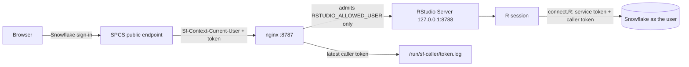
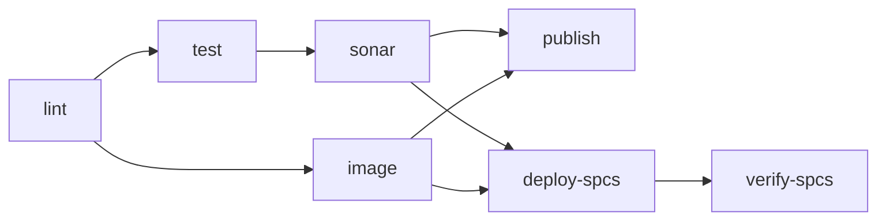

# RStudio on Snowpark Container Services

RStudio Server running inside Snowflake (SPCS) on ARM compute. R code runs as
the signed-in Snowflake user (restricted caller's rights), with no credentials
in the container and no data leaving Snowflake.

## Architecture



| Piece | What it does |
|---|---|
| `Dockerfile` | `rocker/rstudio:4.6.2`, Snowflake ODBC 4.3.0 (checksum-pinned per arch), nginx, R packages. Built for `linux/arm64`. |
| `docker/` | nginx config and s6 services: RStudio on localhost only, nginx in front, caller-token trim loop. |
| `R/connect.R` | One helper for all environments: SPCS caller's rights, SPCS owner mode (jobs), or a PAT locally. |
| `spec/rstudio-service.yaml` | Service spec (`executeAsCaller: true`, `/healthz` probe). Rendered by `scripts/render-spec.sh`. |
| `sql/` | Setup SQL (see below). |
| `scripts/deploy.sh` | Build, push, create/upgrade the service, wait for READY. |
| `tests/` | Test suite, see [tests/README.md](tests/README.md). |
| `local-ci/` | Local CI with act + SonarQube self-scan, see [local-ci/README.md](local-ci/README.md). |

## Security model

| Role | Owns / has | Why |
|---|---|---|
| `RSTUDIO_RUNTIME` | owns `RSTUDIO_SERVICE`; repo READ, pool USAGE; **no data access** | Anyone in RStudio can read the plain SPCS service token (it connects as the owner role), so that role must be harmless. Verified by the integration test. |
| `RSTUDIO_USER` | data in `R_SPCS_DB.PUBLIC`, `MD_TEST_WH`, endpoint access | Granted to the one RStudio user. |
| `CICD` | owns `R_SPCS_DB`, `RSTUDIO_REPO`, `RSTUDIO_POOL`; inherits `RSTUDIO_RUNTIME` | Deploy role (CI). Never owns the service: it inherits `SECURITYADMIN`. |

- **Caller's rights:** R queries run as the signed-in user, limited by the caller grants on `RSTUDIO_RUNTIME` (`R_SPCS_DB.PUBLIC` and `MD_TEST_WH` only). If no caller token is present, `connect.R` fails; it never falls back to the owner role.
- **Single user:** RStudio open source has one `rstudio` user, so nginx admits only `RSTUDIO_ALLOWED_USER` (default `MDAEPPEN`); everyone else gets 403. One service per person.
- **Token lifetime:** caller tokens are valid for 8 hours (`SERVICE_CALLER_TOKEN_VALIDITY_SECS` on the schema). Established connections stay open after that; reload the browser tab to get a fresh token for a new connection.
- **No egress:** R reaches Snowflake over the internal SPCS path; no external access integration. `sql/optional/egress_fallback.sql` is unused.
- **The service owner can't be changed later** (SPCS doesn't support ownership transfer), which is why `deploy.sh` always runs as `RSTUDIO_RUNTIME`.

## Setup

Prerequisites: Docker, the `snow` CLI with a connection (default `DEMO_MDAEPPEN`), and access to the roles above.

1. One-time, as `ACCOUNTADMIN` (edit the user name at the top first):
   ```bash
   snow sql -c <admin-conn> --role ACCOUNTADMIN -f sql/admin/00_setup_roles.sql
   ```
2. Image repository and ARM compute pool, as `CICD`:
   ```bash
   snow sql -c DEMO_MDAEPPEN --role CICD --database R_SPCS_DB --schema PUBLIC -f sql/01_infrastructure.sql
   ```
3. Sample data (idempotent): `tests/seed.sh`
4. Deploy:
   ```bash
   RSTUDIO_ALLOWED_USER=MDAEPPEN scripts/deploy.sh
   ```
5. Open the URL from `SHOW ENDPOINTS IN SERVICE R_SPCS_DB.PUBLIC.RSTUDIO_SERVICE;`, sign in, and **Source** `snowflake_test.R`. It should print `Connected to Snowflake via spcs_caller`.

## Day-2 operations

- Status, logs, suspend and resume: `sql/operations.sql`. The pool auto-suspends after 10 minutes without running services; a suspended service costs nothing.
- **Rollback:** `deploy.sh` prints the previous image tag. Redeploy it with
  `IMAGE_TAG=<previous-tag> SKIP_BUILD=1 scripts/deploy.sh`.
- **Image size:** about 1.1 GB compressed, almost all of it the RStudio base image. The first push takes a few minutes; later pushes only send changed layers.

## Local development

```bash
local/start.sh up      # http://127.0.0.1:8787, PAT from .secrets (SNOWFLAKE_HOST/USER/TOKEN)
tests/run_all.sh       # offline tests
local-ci/act.sh        # the whole CI workflow locally
```

Locally there is no SPCS token, so `connect.R` uses the PAT from `.secrets` (gitignored).

## CI/CD

`.github/workflows/ci.yml` runs the same jobs on GitHub and locally under act:



- Pull requests run `lint`, `test`, `sonar` and `image` only.
- On `main`: the tested arm64 image goes to `ghcr.io/zbrainiac-labs/spcs-rstudio` (with SBOM and provenance) and to `RSTUDIO_REPO`, then the service is upgraded and verified.
- Snowflake auth: GitHub OIDC as `SVC_CICD` / `CICD` (DataOpsBackbone `snowflake-connect` action); under act a PAT via `SNOW_CONFIG_B64`.
- SonarQube: DataOpsBackbone instance, one project per stream (`spcs-rstudio`, `spcs-rstudio-local-pr`, `spcs-rstudio-local`).
